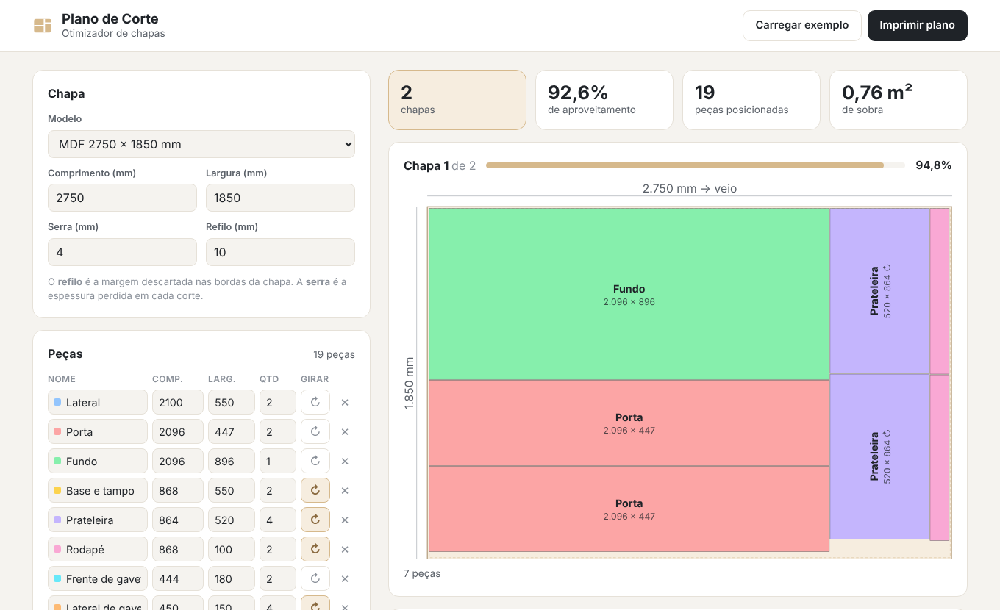

<h1 align="center">🪚 Plano de Corte</h1>

<p align="center">
  Otimizador de plano de corte de chapas: você informa a chapa e as peças, e ele calcula o melhor encaixe, desenha o plano e mostra o aproveitamento.
</p>

<p align="center">
  <a href="https://gabrielevaristo77.github.io/plano-de-corte/">
    
  </a>
  
  
  
  <a href="https://github.com/GabrielEvaristo77/plano-de-corte/actions/workflows/testes.yml">
    
  </a>
</p>

<p align="center">
  <a href="https://gabrielevaristo77.github.io/plano-de-corte/">
    
  </a>
</p>

---

## 🎯 O problema

Quem trabalha com móveis planejados compra chapas de MDF ou compensado em tamanho fixo (por exemplo, 2750 × 1850 mm) e precisa tirar delas todas as peças do projeto. Um encaixe ruim significa comprar mais chapas e jogar material fora.

Este projeto resolve isso: ele testa dezenas de combinações de encaixe e escolhe a que usa **menos chapas**, respeitando as regras reais do corte.

## ✨ Funcionalidades

- **Cortes em guilhotina**: todo corte vai de ponta a ponta, como numa seccionadora ou serra esquadrejadeira
- **Espessura da serra** descontada entre as peças
- **Refilo**: margem descartada nas bordas da chapa
- **Sentido do veio**: cada peça pode girar ou não
- **Desenho de cada chapa** em SVG, com nome e medidas das peças e cotas da chapa
- **Aproveitamento** por chapa e total, área de sobra e **sobras reaproveitáveis**
- **Aviso** para peças maiores que a chapa
- Modelos de chapa prontos (MDF e compensado) ou medida personalizada
- **Imprimir o plano**, só com os desenhos
- Projeto salvo automaticamente no navegador, tema claro e escuro, funciona no celular

## ⚙️ Como o algoritmo funciona

1. As peças são ordenadas, por exemplo da maior área para a menor.
2. Cada peça vai para o espaço livre onde ela sobra menos, em qualquer chapa já aberta. Se não couber em nenhuma, uma chapa nova é aberta.
3. Depois do encaixe, a sobra é dividida em dois retângulos por um corte de ponta a ponta, já descontando a espessura da serra.
4. Os passos acima são repetidos com **40 combinações** de ordenação, critério de encaixe e direção do corte. O resultado com menos chapas vence. No empate, vence o que deixa a última chapa mais livre.

O código está em [`js/otimizador.js`](js/otimizador.js), comentado passo a passo.

## 🧪 Testes

Os testes em [`tests/otimizador.test.js`](tests/otimizador.test.js) conferem, para vários cenários, se:

- nenhuma peça passa da chapa nem invade o refilo
- nenhuma peça encosta em outra sem o espaço da serra
- o plano pode ser cortado em guilhotina (verificação recursiva)
- peças que não podem girar respeitam o veio
- peças maiores que a chapa são avisadas sem travar o cálculo

Os testes rodam automaticamente a cada envio, pelo GitHub Actions.

## 🧠 O que aprendi fazendo

| Parte | O que pratiquei |
|---|---|
| Algoritmo de encaixe | Transformar uma regra do mundo real (corte de ponta a ponta) em código |
| Busca da melhor solução | Testar várias estratégias e comparar os resultados por critérios |
| Desenho do plano | Gerar SVG com JavaScript, com escala, cotas e textos girados |
| Testes | Verificar propriedades do resultado em vez de valores fixos |
| Formulário dinâmico | Lista de peças editável, validação e recálculo automático enquanto se digita |
| CSS | Grid, tema escuro com `prefers-color-scheme` e estilos de impressão |

## ▶️ Como rodar

Abra com um servidor local, porque o projeto usa módulos JavaScript:

```bash
python -m http.server
# depois acesse http://localhost:8000
```

Para os testes (Node.js 20 ou mais recente):

```bash
npm test
```

---

<p align="center">
  Feito por <a href="https://github.com/GabrielEvaristo77">Gabriel Evaristo</a> · estudante de ADS na UNICID
</p>
